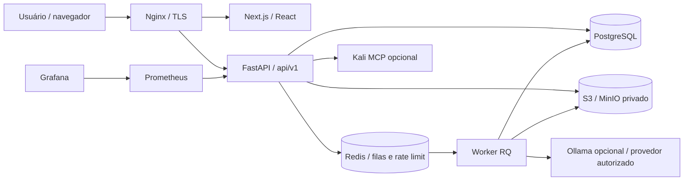
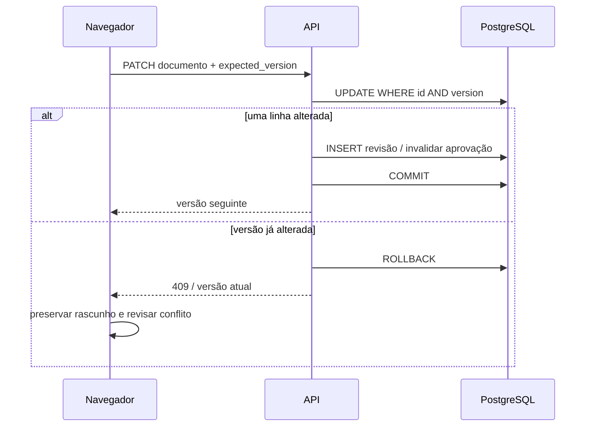

# Arquitetura

## Contexto e componentes

O monólito mantém as regras de autorização e integridade em uma única aplicação. Workers executam funções do mesmo código com processos separados; PostgreSQL é a fonte de estado dos jobs. A separação permite extrair serviços posteriormente sem exigir uma arquitetura distribuída para o fluxo inicial.

## Módulos

| Módulo | Responsabilidade |
|---|---|
| `identity` | Registro, Argon2id, sessões, CSRF e revogação |
| `workspace` | Equipes, convites, competições, desafios, categorias, templates, comentários, revisões, notificações, pesquisa e administração |
| `studio` | Documento canônico, CAS, revisões/diff/restore, snapshots, exportações, publicação e jobs de IA |
| `evidence` | Uploads, MIME real, storage privado, thumbnails, anotações, derivados, versões, tickets e timeline |
| `integrations` | Cliente MCP, bridge Kali, coleta de artefatos e proveniência |
| `security` / `db` | Autorização por recurso, escopo de consultas, auditoria, transações e UTC |

Schemas definem entrada/saída. Services concentram operações e validações; rotas compõem dependências HTTP. Os modelos compartilhados permitem transações entre módulos. As mudanças de schema são migrations Alembic explícitas.

## Documento e concorrência

O documento canônico é JSON v1 com seções `{id,title,markdown}`. Markdown preserva comandos fornecidos; rich-text é uma apresentação editável desse conteúdo. Cada salvamento gera revisão imutável. Associações de evidências e mudanças de conteúdo invalidam aprovação vigente.

## Decisões

- PDF usa **ReportLab** em vez de WeasyPrint. Isso evita dependências de renderização do sistema e busca de URLs/arquivos a partir do conteúdo. Código, tabelas, imagens autorizadas, índice e páginas são gerados localmente.
- Colaboração usa CAS, comentários e revisões. Não há promessa de edição simultânea com CRDT/WebSocket; duas sessões não podem sobrescrever silenciosamente a mesma versão.
- Pesquisa usa full-text do PostgreSQL com índices GIN. SQLite é somente uma alternativa de desenvolvimento/teste com busca lexical; pgvector não é obrigatório.
- O Kali MCP é um bridge próprio de operações tipadas de coleta. O protocolo é inicializado antes de descoberta/chamada; nomes e endpoints não são inventados pelo usuário final.
- Ollama é opcional. O provedor externo depende de configuração da operação e consentimento explícito em cada job.
