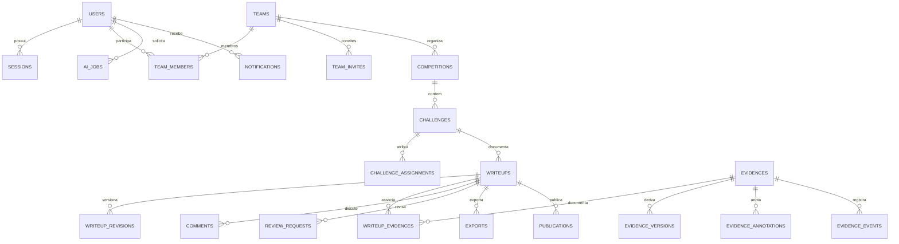

# Banco de dados e integridade

PostgreSQL é o banco de produção. SQLAlchemy 2 mantém os modelos em `apps/api/app/models.py`; UTCDateTime normaliza timestamps conscientes de fuso. SQLite é suportado somente para desenvolvimento e testes isolados.



## Grupos de entidades

- Identidade: users, sessions, teams, team_members, team_invites, roles, permissions, role_permissions.
- Organização: competitions, competition_members, challenges, challenge_assignments, categories, tags.
- Documentos: writeups, writeup_revisions, writeup_templates, template_revisions, writeup_evidences.
- Evidências: evidences, evidence_versions, evidence_annotations, evidence_events.
- Colaboração/entregas: comments, review_requests, notifications, exports, publications, ai_jobs.
- Operação: audit_logs e application_settings.

UUIDs identificam recursos. FKs mantêm integridade referencial; constraints impedem membros duplicados, papéis inválidos e revisões repetidas. A revisão de writeup é única por documento/versão; versões de evidência distinguem original, thumbnail e anotação. Arquivos grandes ficam no object storage, e o banco mantém chaves/hash/metadados.

## Migrations

```sh
cd apps/api
alembic upgrade head
alembic current
alembic history
```

A sequência inclui baseline explícito, adoção de dados legados, dados padrão idempotentes e índices full-text PostgreSQL. A adoção preserva usuários/documentos/evidências do protótipo, normaliza memberships antigas e retira a visibilidade pública legada sem aprovação. Contas com PBKDF2 antigo exigem redefinição administrativa; o runtime aceita somente Argon2id.

Downgrades existem para ensaios em bancos descartáveis. Antes de qualquer downgrade em uma implantação com dados, faça backup completo e revise os passos: remover tabelas novas pode remover dados que não têm equivalente no schema anterior. Não use downgrade como mecanismo rotineiro de recuperação.

## Isolamento e retenção

Filtros de listagem e autorização de recursos usam owner, visibilidade e memberships atuais. FK existente não substitui permissão: criar associações exige autorização sobre os dois recursos e workspace compatível. Recursos principais usam exclusão lógica. A operação deve configurar retenção e revisar órfãos; apagar metadados não autoriza apagar automaticamente originais ou publicações congeladas.
